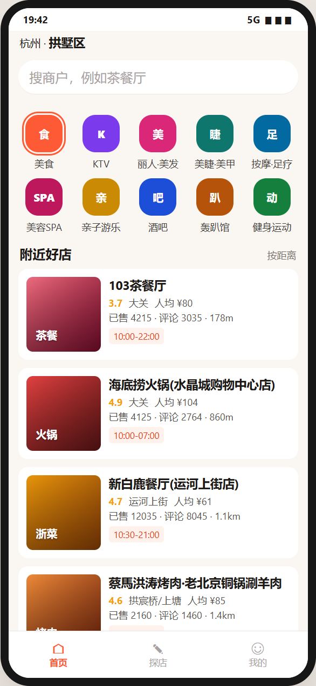
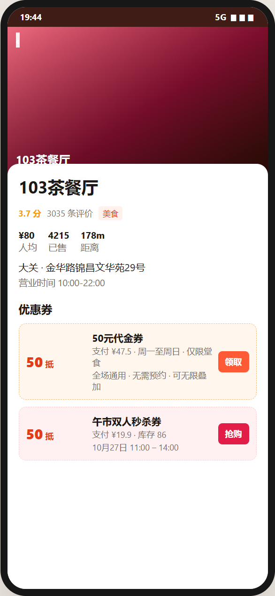
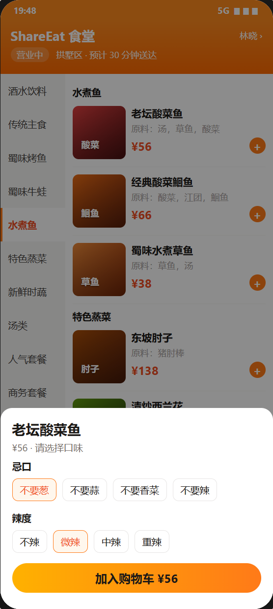
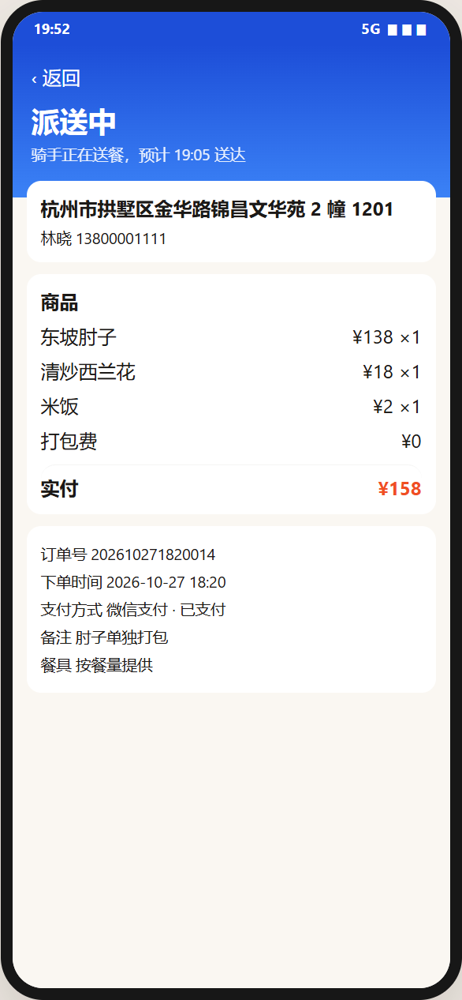
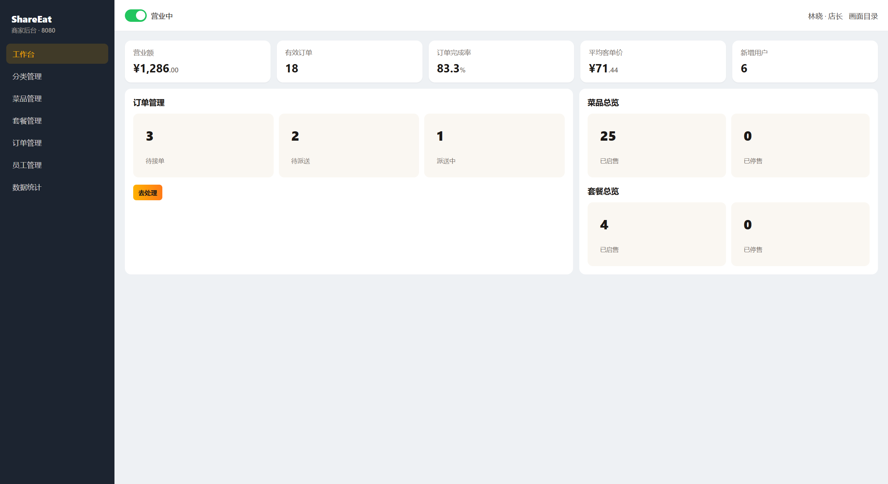
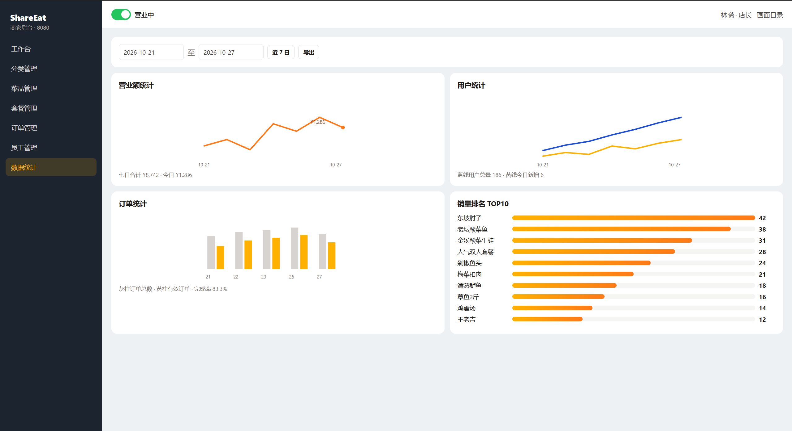

# ShareEat

> Campus store discovery and merchant ordering, as two Spring Boot services

[](https://www.oracle.com/java/)
[](https://spring.io/projects/spring-boot)
[](https://www.mysql.com/)
[](https://redis.io/)

A monorepo for a campus life and commerce platform. Two Spring Boot services sit side by side and keep their own code, schema, and HTTP port. They share one MySQL instance and one Redis instance.

The running demo below is six screenshots: two for the social user client, two for the order user client, and two for the order admin client. The order client and the admin client are both `merchant-order-service` on port 8080.

## About

### What it does

- Store discovery: shop categories, nearby shops, shop detail, cash vouchers, and flash-sale vouchers
- Ordering: the menu, dish flavors, the cart, checkout, and order tracking
- Merchant admin: the workspace, catalog, orders, employees, and sales reports

Each service owns its tables. Shop data in `shareeat_social` and orders in `shareeat_merchant` stay in separate schemas, and each service uses its own Redis logical database.

### Technology

#### social-discovery-service

- **Spring Boot 2.3.12** on port 8081, Java 8
- **MyBatis-Plus** against schema `shareeat_social`
- **Redis** logical database 0, for cache and flash-sale stock

#### merchant-order-service

- **Spring Boot 2.7.3** on port 8080, Java 8
- **MyBatis**, **Druid**, and **JWT** against schema `shareeat_merchant`
- **Redis** logical database 10
- User APIs and admin APIs are two clients of this one process

#### Shared infrastructure

- **MySQL 8** on port 3306, user `root`, one schema per service
- **Redis 7** on port 6379, with a password and separate logical databases

## Running demo

These are screenshots of the three clients. Each link opens the image file in `demo/`.

### Social user client

`social-discovery-service` on port 8081. This client is for finding shops.

The home page lists categories and nearby shops in Gongshu, Hangzhou.

[](./demo/Snipaste_2026-10-27_20-05-56.png)

The shop page for 103茶餐厅 shows a cash voucher and a lunch flash-sale voucher.

[](./demo/Snipaste_2026-10-27_20-06-22.png)

### Order user client

`merchant-order-service` on port 8080, the user ordering client.

The menu opens a flavor sheet for 老坛酸菜鱼, with dietary notes and spice level, before the dish goes into the cart.

[](./demo/Snipaste_2026-10-27_20-13-12.png)

An order in delivery shows the address, line items, and payment.

[](./demo/Snipaste_2026-10-27_20-13-03.png)

### Order admin client

The same `merchant-order-service` on port 8080, the merchant admin client.

The workspace shows today's turnover, open orders, and counts for dishes and set meals.

[](./demo/Snipaste_2026-10-27_20-05-38.png)

The report page charts turnover, users, orders, and the top 10 dishes over the last seven days.

[](./demo/Snipaste_2026-10-27_20-11-25.png)

## Quick start

### Requirements

- **Java**: JDK 8+
- **Maven**: 3.6+
- **Docker**: for MySQL 8 and Redis 7

### Run it

#### 1. Start MySQL and Redis

```bash
docker compose up -d
```

A fresh data volume loads `shareeat_social` and `shareeat_merchant` from the SQL files mounted in `docker-compose.yml`.

#### 2. Start social-discovery-service

```bash
cd social-discovery-service
mvn spring-boot:run
```

The server listens on <http://localhost:8081>. Connection settings are in `social-discovery-service/src/main/resources/application.yaml`.

#### 3. Start merchant-order-service

`merchant-server/src/main/resources/application.yml` activates the `dev` profile. Create `application-dev.yml` in that same directory. It is gitignored. Fill the datasource, Redis, Aliyun OSS, and WeChat values that `application.yml` already interpolates:

```yaml
merchant:
  datasource:
    driver-class-name: com.mysql.cj.jdbc.Driver
    host: 127.0.0.1
    port: 3306
    database: shareeat_merchant
    username: root
    password: your MySQL password
  redis:
    host: 127.0.0.1
    port: 6379
    password: your Redis password
    database: 10
  alioss:
    endpoint: your OSS endpoint
    access_key_id: your access key id
    access_key_secret: your access key secret
    bucket_name: your bucket name
  wechat:
    appid: your WeChat app id
    secret: your WeChat secret
```

```bash
cd merchant-order-service
mvn spring-boot:run -pl merchant-server -am
```

The server listens on <http://localhost:8080>.

## Architecture

```text
┌────────────────────────────┐         ┌────────────────────────────┐
│ social-discovery-service   │         │ merchant-order-service     │
│ port 8081                  │         │ port 8080                  │
│ schema shareeat_social     │         │ schema shareeat_merchant   │
│ Redis logical DB 0         │         │ Redis logical DB 10        │
│ user client: store discovery│        │ user client and admin      │
└─────────────┬──────────────┘         └─────────────┬──────────────┘
              │                                      │
              └──────────────────┬───────────────────┘
                                 │
                    ┌────────────┴────────────┐
                    │ MySQL :3306             │
                    │ Redis :6379             │
                    └─────────────────────────┘
```

## Core modules

- `social` `ShopController` and `ShopTypeController`: shop list, shop detail, and categories
- `social` `VoucherController` and `VoucherOrderController`: cash vouchers and flash sales
- `social` `BlogController` and `UserController`: notes and phone login
- `merchant` user `CategoryController`, `DishController`, `SetmealController`, and `ShoppingCartController`: the menu and the cart
- `merchant` user `OrderController`: checkout and order tracking
- `merchant` admin `WorkSpaceController`, `OrderController`, `ReportController`, and `EmployeeController`: the workspace, orders, reports, and staff

## Layout

```text
ShareEat/
├── README.md
├── docker-compose.yml
├── demo/                         # screenshots of the three clients
├── merchant-order-service/       # catalog, cart, and order fulfillment, port 8080
│   ├── merchant-common/
│   ├── merchant-pojo/
│   └── merchant-server/
└── social-discovery-service/     # store discovery and voucher flash sales, port 8081
```

## Acknowledgements

- [Spring Boot](https://spring.io/projects/spring-boot) - application framework
- [MyBatis](https://mybatis.org/mybatis-3/) and [MyBatis-Plus](https://baomidou.com/) - database access
- [MySQL](https://www.mysql.com/) - relational storage
- [Redis](https://redis.io/) - cache and flash-sale stock
