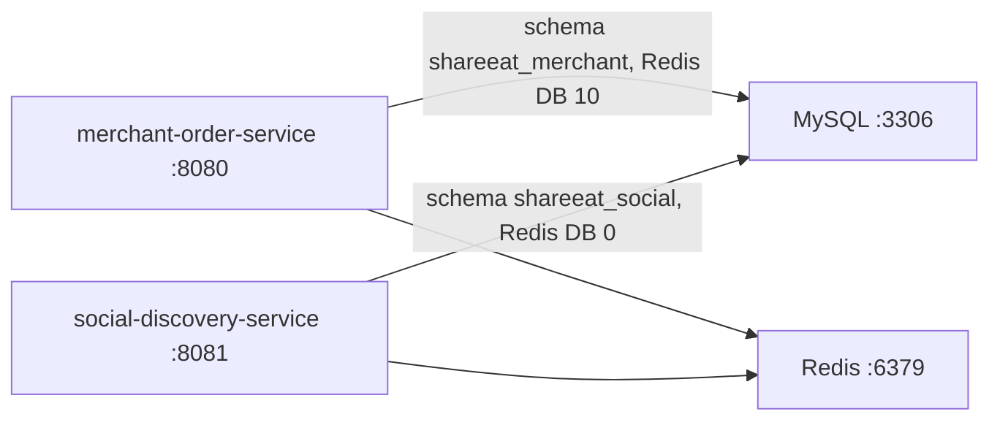

# ShareEat

A monorepo for a campus life and commerce platform. Two Spring Boot services sit side by side and keep their own code, schema, and HTTP port. They share one MySQL instance and one Redis instance.

## Layout

```text
ShareEat/
├── README.md
├── docker-compose.yml
├── merchant-order-service/      # catalog, cart, and order fulfillment
└── social-discovery-service/    # store discovery and voucher flash sales
```

## Architecture



| Service | Port | Schema | Redis logical DB | Stack |
|---|---|---|---|---|
| merchant-order-service | 8080 | `shareeat_merchant` | 10 | Spring Boot 2.7, MyBatis, Druid, JWT |
| social-discovery-service | 8081 | `shareeat_social` | 0 | Spring Boot 2.3, MyBatis-Plus, Redis |

Both applications use MySQL user `root` and the same Redis password. Separate schemas and Redis DB indexes keep their data apart.
